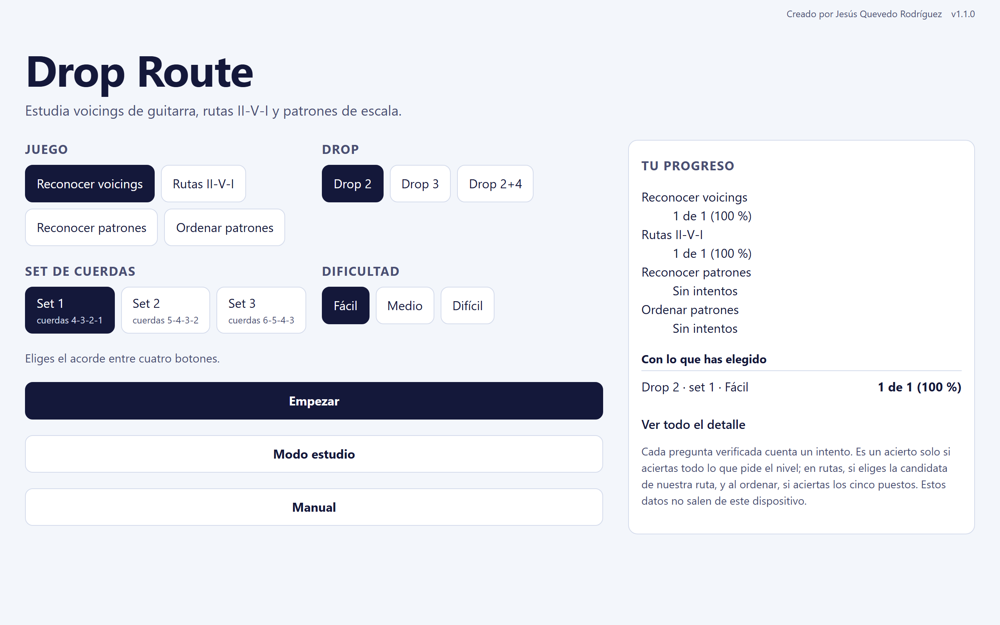

# Drop Route: manual de instalación

Autor: Jesús Quevedo Rodríguez. Versión 1.1.0.

La aplicación se puede abrir en el navegador o instalar como PWA. La dirección prevista para GitHub Pages es <https://a01653.github.io/Drop_Route/>. Solo debe darse por activa después de que el despliegue de `main` termine correctamente.

## 1. Usar la aplicación publicada

Abre la dirección HTTPS y espera a que aparezca el menú. La primera carga completa permite que el service worker guarde los recursos necesarios para el uso sin conexión.

En Android con Chrome, abre el menú del navegador y usa la opción de instalación o creación de acceso directo que ofrezca la versión instalada. En Chrome de escritorio puede aparecer **Instalar página como aplicación**. En Safari de iPhone, usa **Compartir → Añadir a pantalla de inicio**.

Los nombres exactos de los menús cambian según la versión del navegador. La instalación PWA necesita HTTPS o `localhost`; una URL HTTP de la red local no sirve para registrar el service worker.

## 2. Probar desde el código

Requisitos para construir y servir la aplicación:

- Node.js 22.13 o posterior.
- npm.
- Git.

Clona el repositorio y carga las dependencias:

```bash
git clone https://github.com/a01653/Drop_Route.git Drop_Route
cd Drop_Route
npm ci --ignore-scripts
```

Para desarrollo:

```bash
npm run dev
```

Para probar el build que incluye la PWA:

```bash
npm run build
npm run preview
```



*Figura 1. Vista de escritorio del build.*

## 3. Publicar en la subruta de GitHub Pages

GitHub Pages sirve este repositorio bajo la ruta `/Drop_Route/`. El build debe conocer esa base:

```bash
DROP_ROUTE_BASE=/Drop_Route/ npm run build
```

En PowerShell:

```powershell
$env:DROP_ROUTE_BASE = '/Drop_Route/'
npm run build
```

El resultado queda en `dist/`.

## 4. GitHub Pages

El workflow `.github/workflows/deploy-pages.yml` se ejecuta al hacer push a `main` y también admite ejecución manual. Usa dos trabajos: uno construye `dist/` con la base `/Drop_Route/`; el segundo publica el artefacto en GitHub Pages.

Si Pages aún no está activado en el repositorio, entra en **Settings → Pages** y selecciona **GitHub Actions** como origen. Después ejecuta de nuevo el workflow.

Cuando el despliegue termine en verde, comprueba <https://a01653.github.io/Drop_Route/> con conexión y después una recarga sin conexión.

## 5. Pruebas opcionales

Para las pruebas E2E y las capturas de los manuales hace falta Chromium de Playwright:

```bash
npx playwright install chromium
npm run test:e2e
npm run docs:captures
```

La generación de los PDF de documentación usa Python 3.10 o posterior, Pandoc y LuaLaTeX o XeLaTeX.
