# Drop Route: manual de uso

Autor: Jesús Quevedo Rodríguez. Versión 1.1.0.

Drop Route es un juego para estudiar voicings de guitarra, recorridos II-V-I y patrones de escala. Las preguntas de voicings y rutas trabajan en Do (C), sin audio; las de escalas se juegan en la tonalidad que elijas y el modo estudio permite transponer las formas. Guarda el progreso en el navegador del dispositivo; no usa cuentas ni sincroniza datos.

## 1. Elegir qué practicar

Al abrir la aplicación aparece el menú. Puedes elegir **Reconocer voicings**, **Rutas II-V-I**, **Reconocer patrones**, **Ordenar patrones** o **Modo estudio**.

En reconocimiento seleccionas Drop, set de cuerdas y dificultad. En rutas se usa Drop 2 y eliges set, modo mayor o menor y tramo de la secuencia. En los dos juegos de escalas eliges la escala y la tonalidad, en lugar de Drop y set. El modo estudio sirve para consultar formas, rutas y patrones sin responder preguntas.

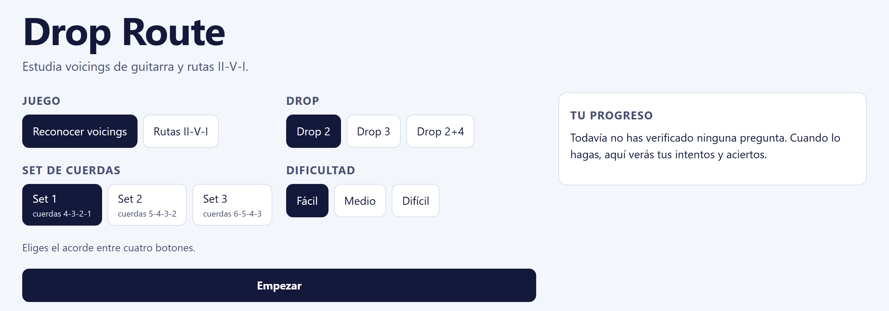

*Figura 1. Menú de reconocimiento.*

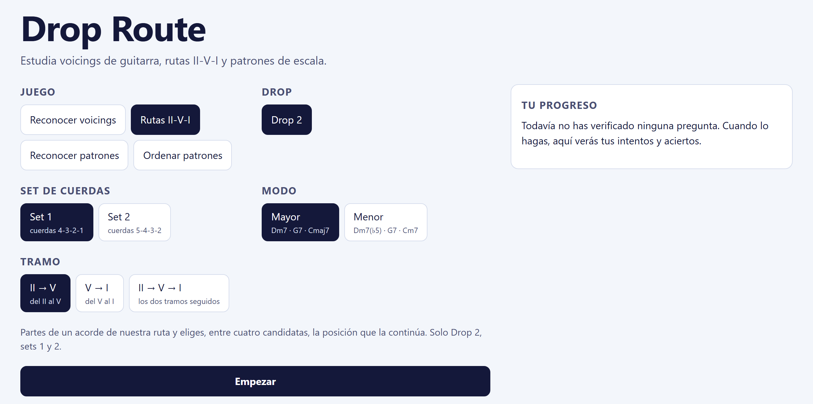

*Figura 2. Menú de rutas II-V-I.*

## 2. Reconocer voicings

Cada pregunta muestra una tarjeta neutra: ves la posición física de las notas, pero no el nombre del acorde ni los grados de la solución.

### Fácil

Elige entre Cmaj7 / C6, C7, Cm7 y Cm7(b5). El orden cambia entre preguntas. La opción mayor agrupa las formas con séptima y con sexta; siempre tiene el mismo nombre para no dar pistas. Cuando la plantilla usa C6, se pregunta esa posición con sexta y, al corregir, la séptima original aparece en gris como referencia. Las formas mantienen cuatro voces activas.

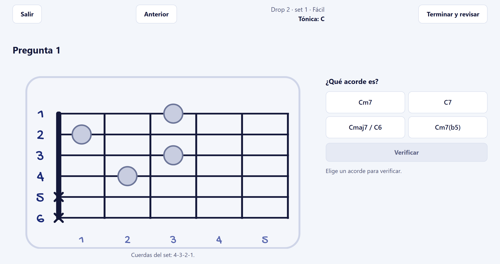

*Figura 3. Nivel fácil antes de verificar.*

Al verificar, la respuesta se bloquea. Si fallas, el acorde elegido se marca y la solución queda identificada también con texto y símbolos.

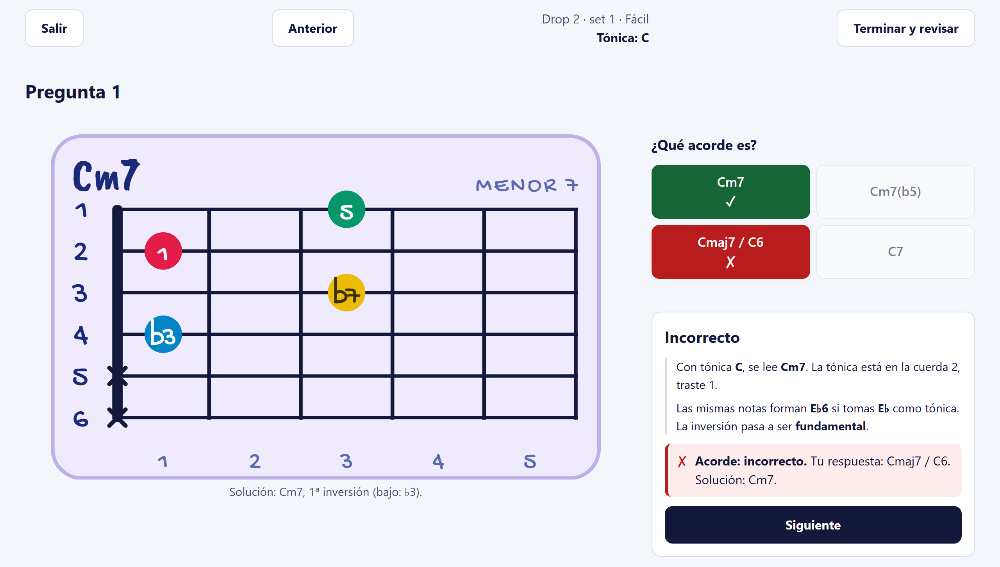

*Figura 4. Corrección del nivel fácil.*

### Medio

Indica el acorde y la inversión con los dos selectores. La aplicación comprueba ambos campos por separado.

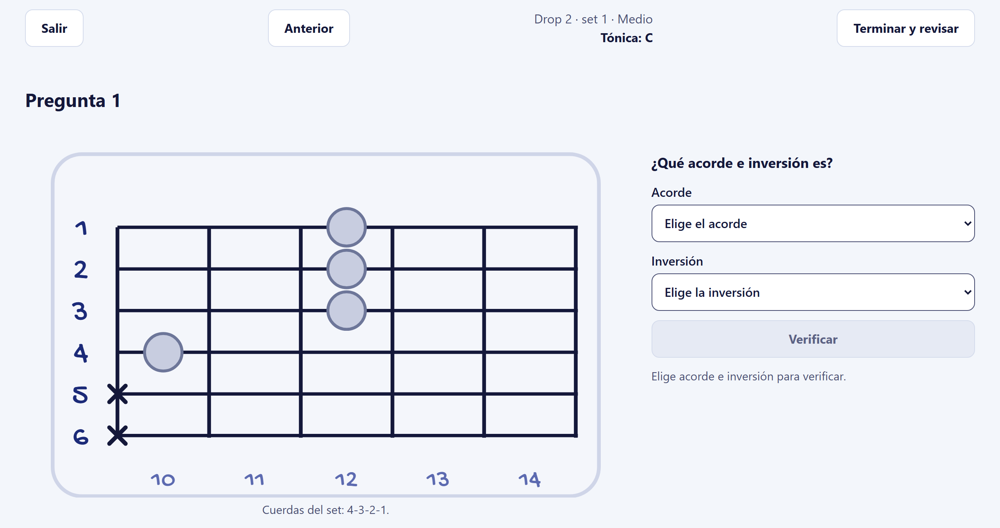

*Figura 5. Nivel medio antes de verificar.*

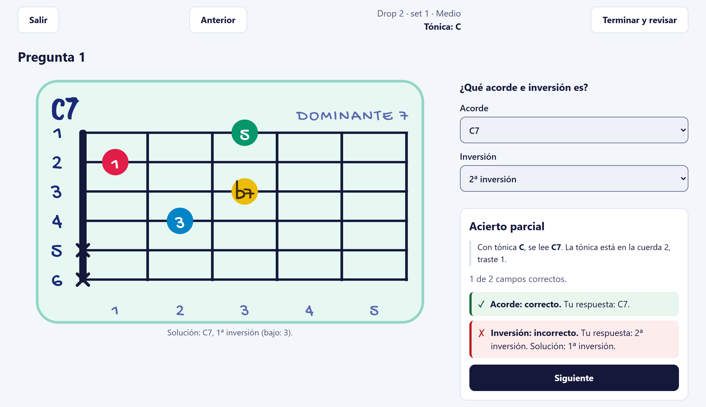

*Figura 6. Corrección campo por campo.*

### Difícil

Además del acorde y la inversión, coloca los cuatro grados sobre los círculos de la tarjeta. El banco incluye siempre 1, 3, ♭3, 5, ♭5, 6, 7 y ♭7. En las variantes con sexta se coloca 6, no 7, en su círculo. Puedes arrastrar, usar dos toques, teclado o los controles de colocación sin arrastre.

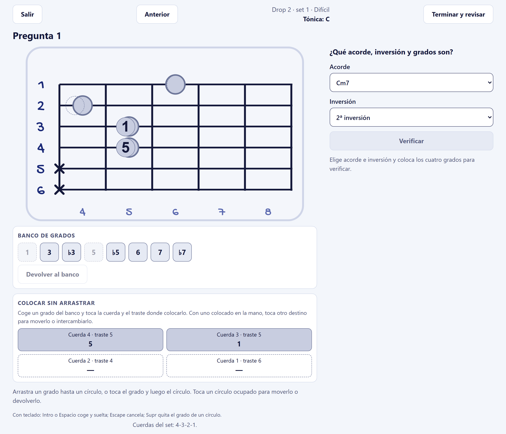

*Figura 7. Nivel difícil durante la respuesta.*

La corrección compara acorde, inversión y cada círculo. Solo cuenta como acierto completo cuando todos los campos son correctos.

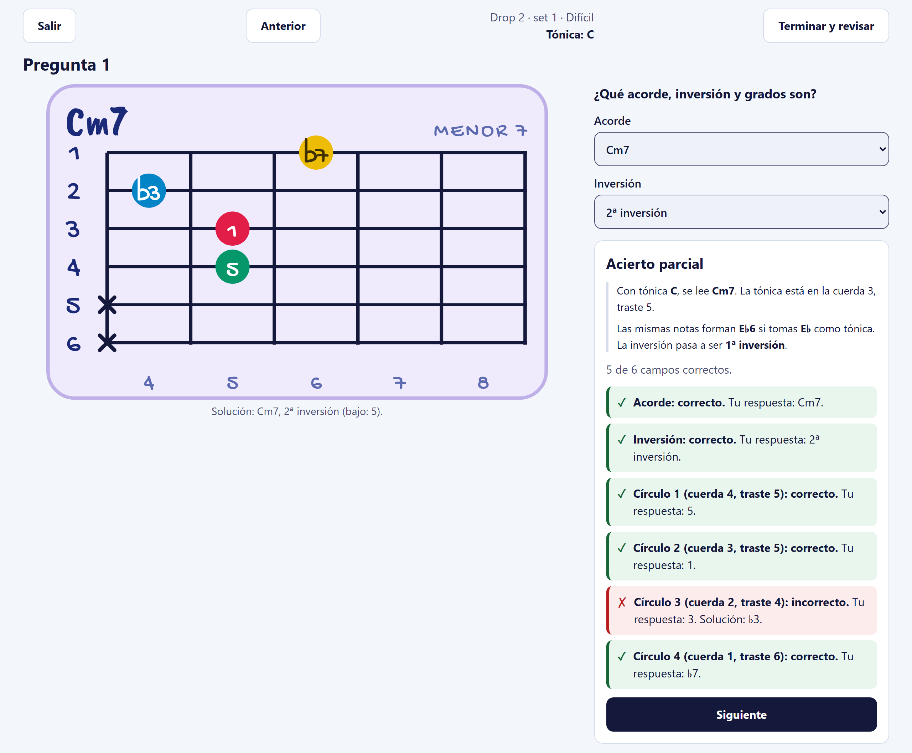

*Figura 8. Corrección del nivel difícil.*

## 3. Rutas II-V-I

Las rutas disponibles son:

- Mayor: Dm7 → G7 → Cmaj7.
- Menor: Dm7(♭5) → G7 → Cm7.

Elige el tramo **II → V**, **V → I** o **II → V → I**. La partida se mantiene visible y debajo aparece una candidata. Cambia entre las cuatro posiciones con el selector 1-4, el gesto lateral o el teclado.

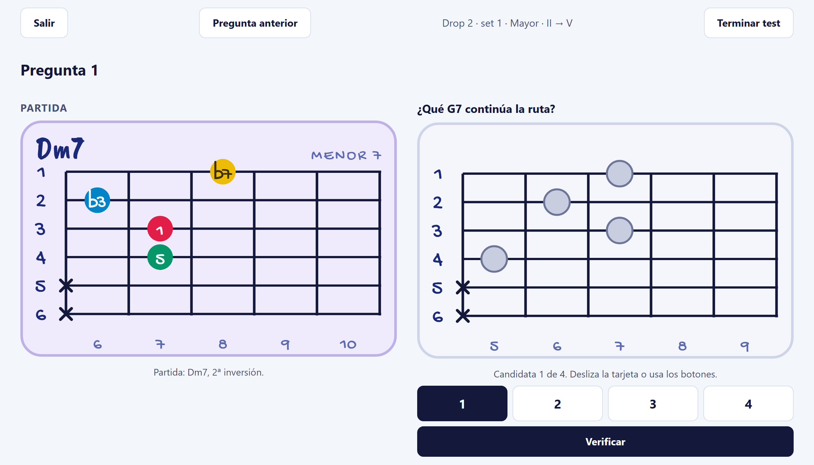

*Figura 9. Partida, candidata y selector.*

La verificación indica si elegiste la posición usada por esa ruta. Otra inversión del mismo acorde puede ser musicalmente válida y, aun así, no ser la posición de la secuencia estudiada.

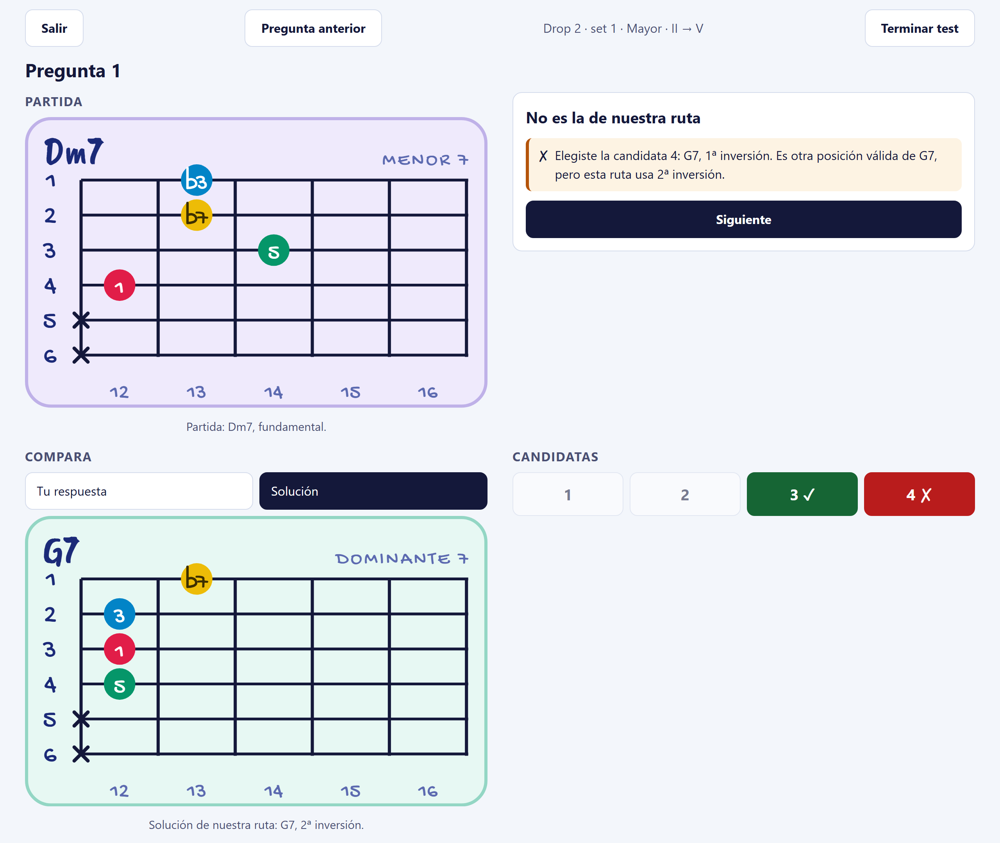

*Figura 10. Solución de la ruta.*

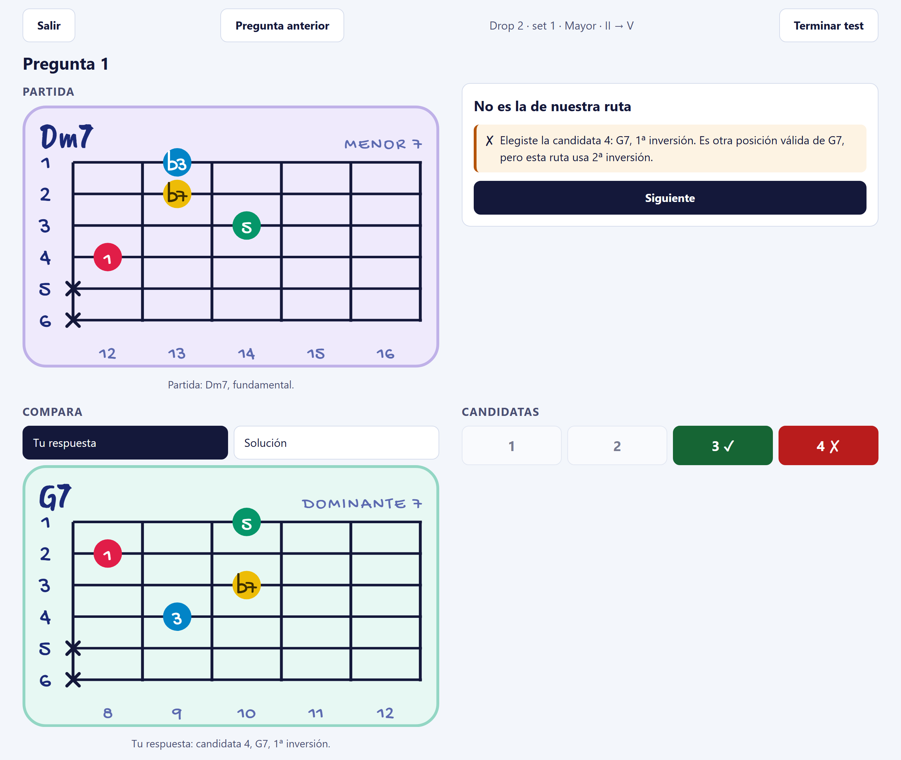

*Figura 11. Comparación con tu respuesta.*

## 4. Patrones de escala

Hay cuatro escalas: **Mayor**, **Pentatónica mayor**, **Pentatónica menor** y **Menor natural**, con cinco patrones cada una. Se numeran subiendo por el mástil y llevan también el nombre de su forma CAGED:

- Patrón 1 = forma E, 2 = D, 3 = C, 4 = A y 5 = G.
- En las escalas menores, la forma es la de su propio acorde menor: Em, Dm, Cm, Am y Gm.

En el menú eliges la escala y la **Tonalidad**: una de las doce o **Aleatoria**, que cambia en cada pregunta. Cada patrón se coloca entero en su posición más grave de esa tonalidad.

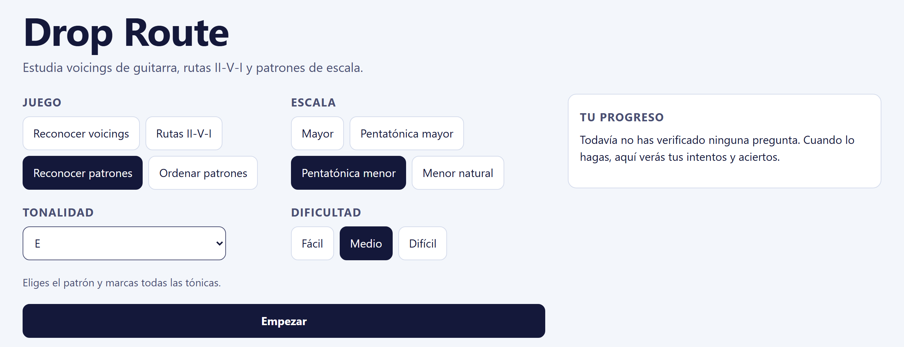

*Figura 12. Menú de los juegos de escalas.*

### Reconocer patrones

La tarjeta muestra el patrón con círculos grises y los números de traste; arriba se indica la tónica.

1. **Fácil:** toca el botón del patrón (por ejemplo, **Patrón 2 · forma D**).
2. **Medio:** elige el patrón y toca todas las notas que sean tónica. Vuelve a tocar una nota para quitar la marca.
3. **Difícil:** elige el patrón y marca todas las tónicas, terceras, quintas y séptimas. En las escalas menores son ♭3 y ♭7; en la pentatónica mayor, que no tiene séptima, se marca la sexta (6). Elige un grado en **Grado que marcas** y toca las notas que lo llevan; **Borrar** quita marcas.

Las demás notas del patrón se dejan sin marcar.

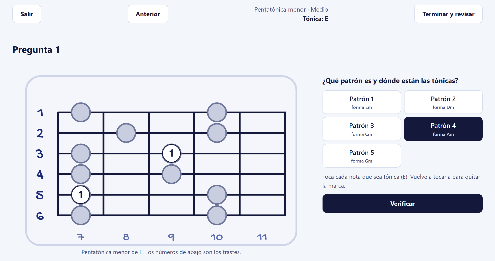

*Figura 13. Medio: patrón elegido y tónicas marcadas.*

Al verificar, la tarjeta recupera los colores: tónica en rojo, tercera en azul, quinta en verde, y séptima o sexta en amarillo. La corrección dice qué notas faltaban y cuáles sobraban en cada grado. En **Tus marcas**, cada nota lleva un aro:

- verde, si está bien marcada;
- rojo, si la marca es errónea;
- discontinuo, si faltaba marcarla.

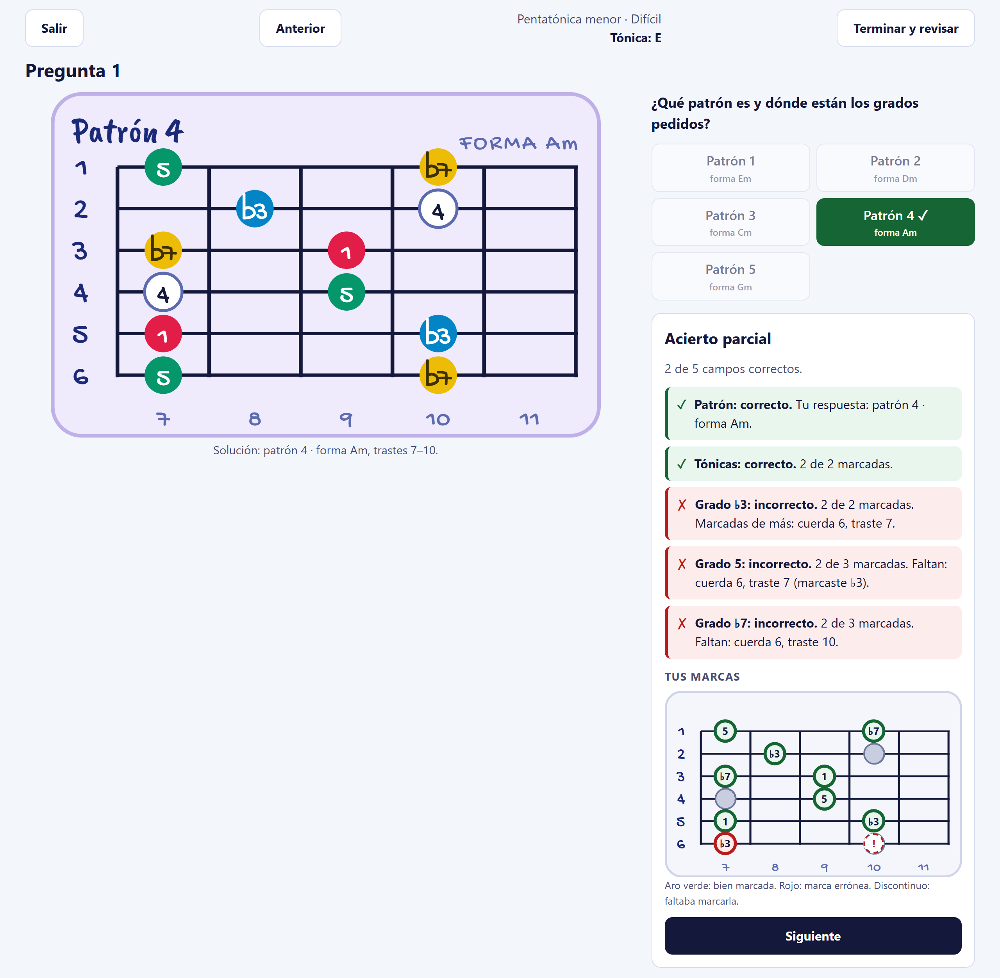

*Figura 14. Difícil: corrección y aros sobre tus marcas.*

### Ordenar patrones

Aparecen los cinco patrones barajados, con las letras A a E y sin números de traste ni cejuelo. Tócalos de grave a agudo, empezando por el que queda más cerca del cejuelo. Tocar de nuevo una tarjeta la quita del orden, y **Borrar orden** empieza de cero.

El orden depende de la tonalidad. Por ejemplo, en Do mayor es 3-4-5-1-2 y en Mi mayor, 2-3-4-5-1.

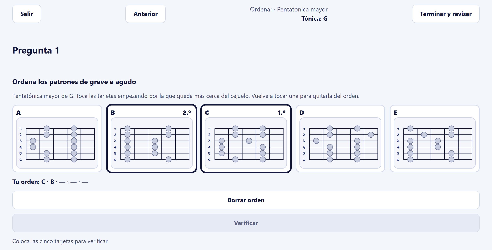

*Figura 15. Ordenar: tarjetas sin trastes.*

Al verificar se corrige cada puesto y se muestra el orden correcto, con colores y trastes.

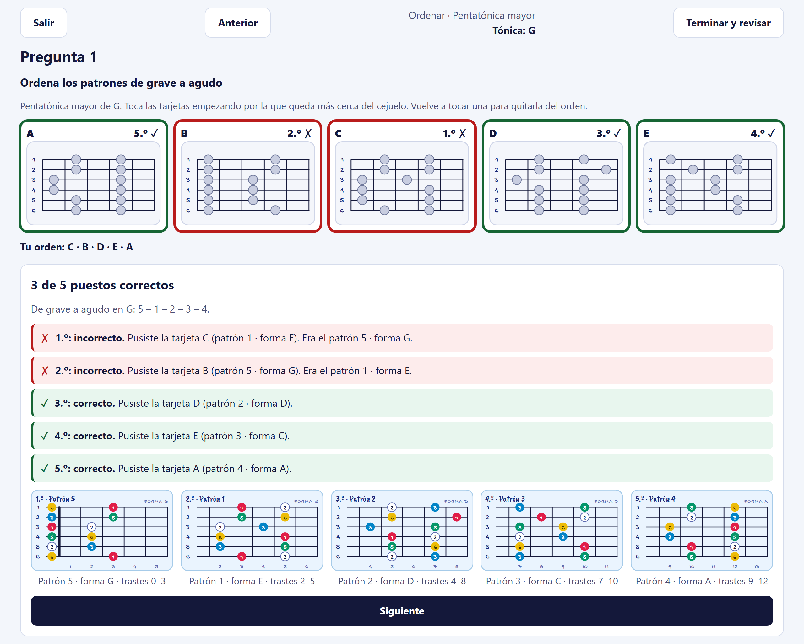

*Figura 16. Ordenar: corrección y orden correcto.*

Los dos juegos tienen **Anterior**, **Siguiente** y **Terminar y revisar**, como el reconocimiento de voicings.

## 5. Modo estudio

En el menú, abre **Modo estudio**. Elige qué estudiar y la tonalidad. El modo estudio no suma intentos ni modifica el progreso.

**Rutas II-V-I:** elige el set, el modo mayor o menor y la ruta. Verás los acordes II, V e I juntos y el movimiento de las voces. La columna sombreada marca el traste donde cae la raíz del acorde II. Se repite en las tres tarjetas y se desplaza al cambiar de tonalidad. El número de ese traste aparece en negrita.

**Patrones de escala:** elige la escala y el orden, **Por número** o **De grave a agudo**. Verás los cinco patrones con su número, su forma CAGED y los trastes que ocupan. Las cuerdas al aire aparecen a la izquierda del cejuelo.

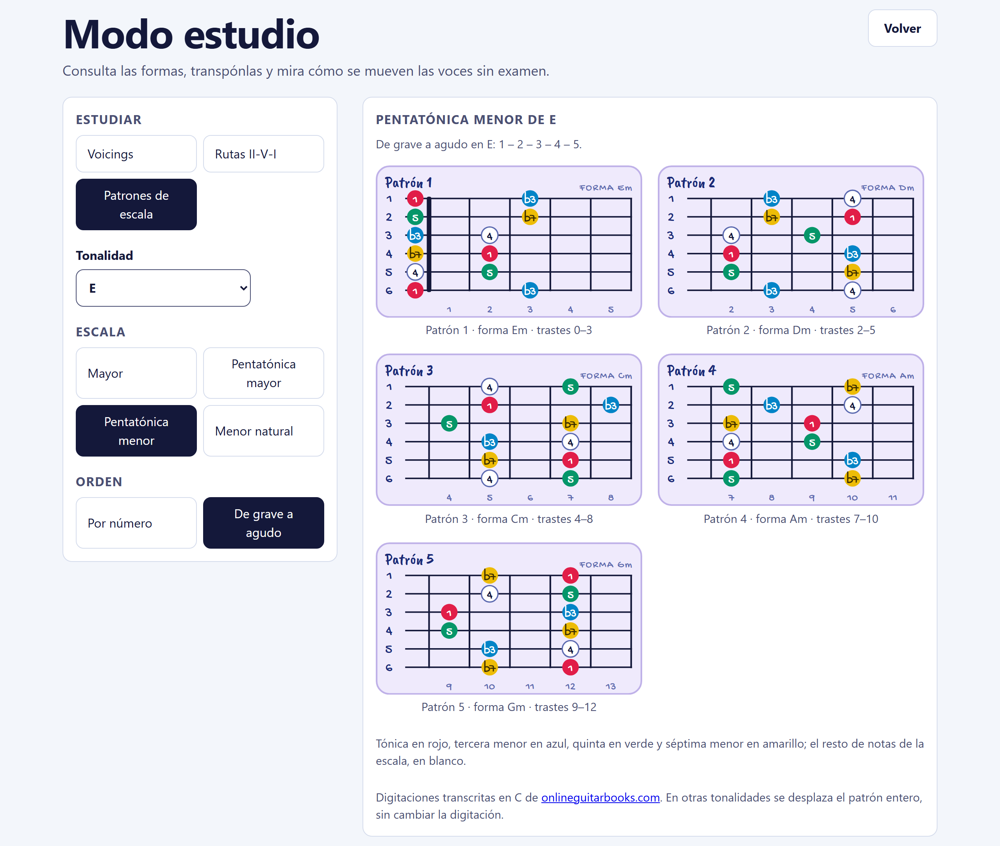

*Figura 17. Estudio de patrones de escala.*

## 6. Progreso

Cada pregunta suma un intento cuando pulsas **Verificar**. Salir, cambiar una selección o mirar la corrección no añade intentos. El panel del menú muestra intentos y aciertos de cada juego y de la configuración elegida. Los patrones cuentan por escala y dificultad, y al ordenar, por escala.

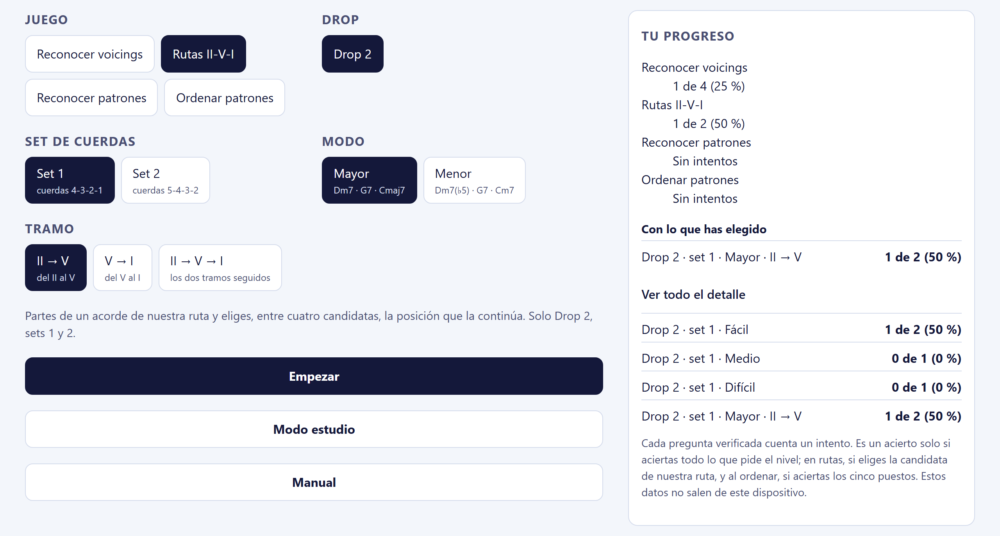

*Figura 18. Detalle del progreso local.*

Los datos quedan en este navegador y dispositivo. Si borras los datos del sitio, se pierde ese progreso. Si el navegador no puede guardar, Drop Route lo avisa y permite seguir jugando en memoria. Al actualizar desde una versión anterior, el progreso se conserva.

## 7. Actualizar y jugar sin conexión

Después de una primera carga completa con conexión, la PWA guarda los recursos de la aplicación para poder recargar y jugar sin red.

Cuando hay una versión nueva, el menú ofrece **Actualizar ahora**. La versión nueva no se activa mientras tienes una pregunta abierta. Si existen cambios que solo están en memoria, el aviso lo indica antes de actualizar.

## 8. Límites de esta entrega

- No incluye audio, cuentas, sincronización, notificaciones, sesiones adaptativas ni restauración del progreso.
- Las preguntas de voicings y rutas siguen en C. Las rutas se limitan a Drop 2 en los sets 1 y 2.
- Los patrones de escala son las cinco formas movibles de la fuente: no incluyen digitaciones en posición abierta ni de tres notas por cuerda.
- En Medio y Difícil, el área que se puede tocar en cada nota es su celda del diagrama, más pequeña que los botones.
