# Drop Route: manual de uso

Autor: Jesús Quevedo Rodríguez. Paquete 0.0.0, candidato para revisión.

Drop Route es un juego para estudiar voicings de guitarra y recorridos II-V-I. Esta entrega trabaja en Do (C), sin audio ni transposición. Guarda el progreso en el navegador del dispositivo; no usa cuentas ni sincroniza datos.

## 1. Elegir qué practicar

Al abrir la aplicación aparece el menú. Puedes elegir **Reconocer voicings** o **Rutas II-V-I**.

En reconocimiento seleccionas Drop, set de cuerdas y dificultad. En rutas se usa Drop 2 y eliges set, modo mayor o menor y tramo de la secuencia.

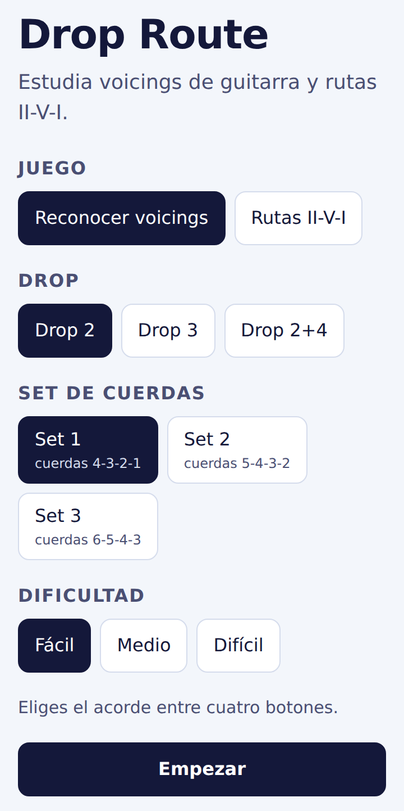

*Figura 1. Menú de reconocimiento.*

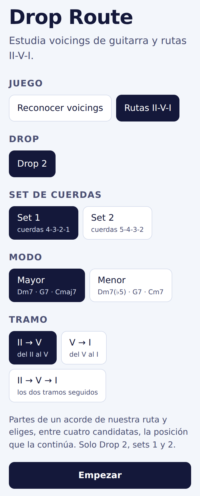

*Figura 2. Menú de rutas II-V-I.*

## 2. Reconocer voicings

Cada pregunta muestra una tarjeta neutra: ves la posición física de las notas, pero no el nombre del acorde ni los grados de la solución.

### Fácil

Elige el acorde entre Cmaj7, C7, Cm7 y Cm7(b5). El orden de los botones cambia entre preguntas.

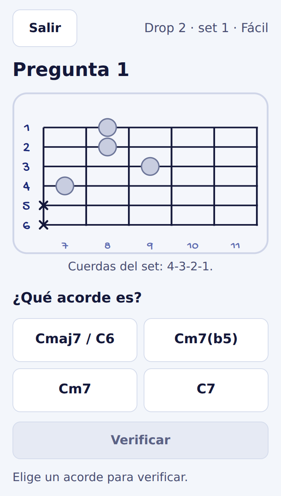

*Figura 3. Nivel fácil antes de verificar.*

Al verificar, la respuesta se bloquea. Si fallas, el acorde elegido se marca y la solución queda identificada también con texto y símbolos.

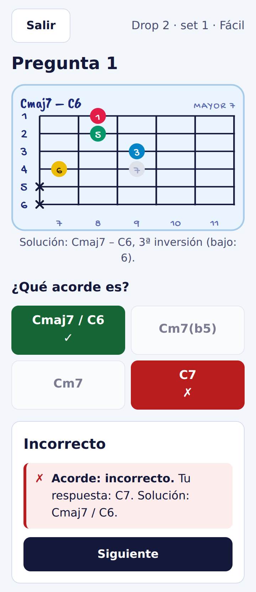

*Figura 4. Corrección del nivel fácil.*

### Medio

Indica el acorde y la inversión con los dos selectores. La aplicación comprueba ambos campos por separado.

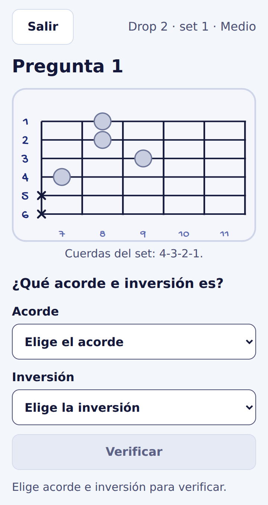

*Figura 5. Nivel medio antes de verificar.*

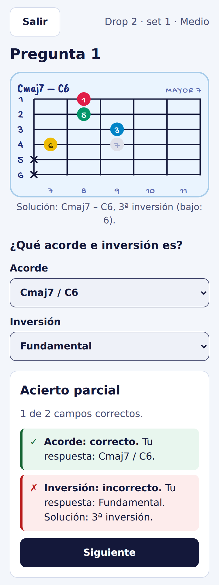

*Figura 6. Corrección campo por campo.*

### Difícil

Además del acorde y la inversión, coloca los cuatro grados sobre los círculos de la tarjeta. El banco incluye 1, 3, ♭3, 5, ♭5, 7 y ♭7. Puedes arrastrar, usar dos toques, teclado o los controles de colocación sin arrastre.

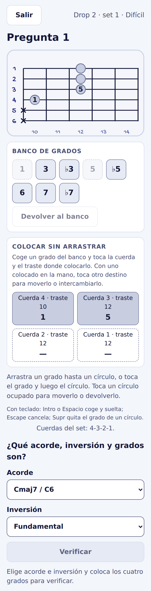

*Figura 7. Nivel difícil durante la respuesta.*

La corrección compara acorde, inversión y cada círculo. Solo cuenta como acierto completo cuando todos los campos son correctos.

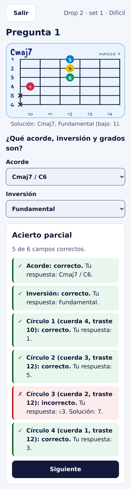

*Figura 8. Corrección del nivel difícil.*

## 3. Rutas II-V-I

Las rutas disponibles son:

- Mayor: Dm7 → G7 → Cmaj7.
- Menor: Dm7(♭5) → G7 → Cm7.

Elige el tramo **II → V**, **V → I** o **II → V → I**. La partida se mantiene visible y debajo aparece una candidata. Cambia entre las cuatro posiciones con el selector 1-4, el gesto lateral o el teclado.

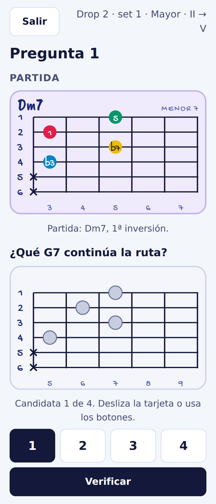

*Figura 9. Partida, candidata y selector.*

La verificación indica si elegiste la posición usada por esa ruta. Otra inversión del mismo acorde puede ser musicalmente válida y, aun así, no ser la posición de la secuencia estudiada.

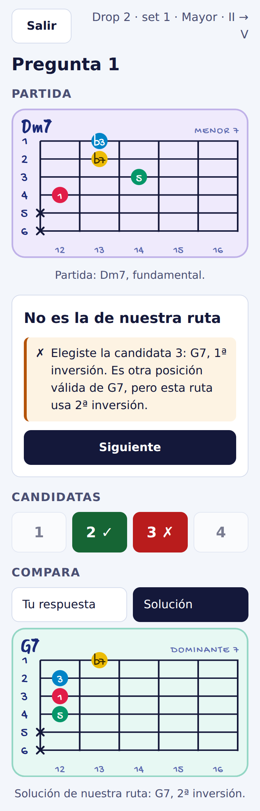

*Figura 10. Solución de la ruta.*

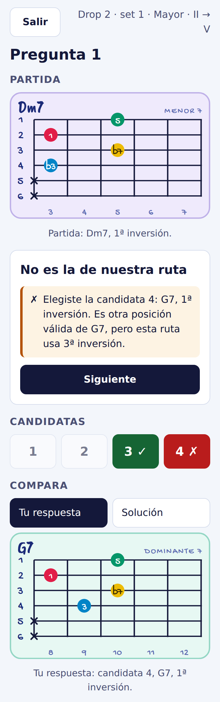

*Figura 11. Comparación con tu respuesta.*

## 4. Progreso

Cada pregunta suma un intento cuando pulsas **Verificar**. Salir, cambiar una selección o mirar la corrección no añade intentos. El panel del menú muestra intentos y aciertos por juego y configuración.

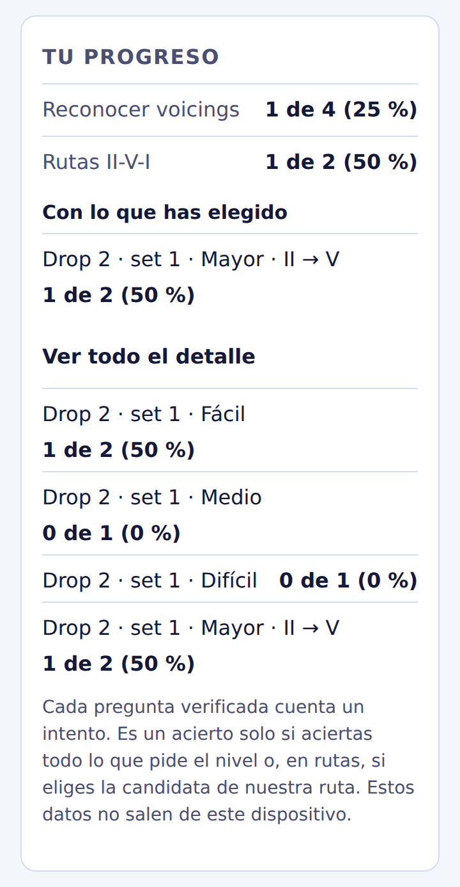

*Figura 12. Detalle del progreso local.*

Los datos quedan en este navegador y dispositivo. Si borras los datos del sitio, se pierde ese progreso. Si el navegador no puede guardar, Drop Route lo avisa y permite seguir jugando en memoria.

## 5. Actualizar y jugar sin conexión

Después de una primera carga completa con conexión, la PWA guarda los recursos de la aplicación para poder recargar y jugar sin red.

Cuando hay una versión nueva, el menú ofrece **Actualizar ahora**. La versión nueva no se activa mientras tienes una pregunta abierta. Si existen cambios que solo están en memoria, el aviso lo indica antes de actualizar.

## 6. Límites de esta entrega

No incluye audio, transposición, cuentas, sincronización entre dispositivos, notificaciones, sesiones adaptativas ni una pantalla para restaurar copias del progreso. Las rutas se limitan a Drop 2, sets 1 y 2.
